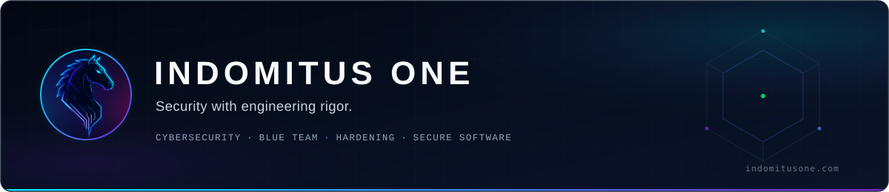

<picture>
  <source media="(prefers-color-scheme: dark)" srcset="assets/banner-dark.svg" />
  <source media="(prefers-color-scheme: light)" srcset="assets/banner-light.svg" />
  
</picture>

 

---

## About Indomitus One

**Indomitus One** is an independent cybersecurity and software engineering project by **Jose Alonso**, focused on practical defensive engineering, system hardening, security research, and building clean, auditable tools.

This GitHub profile serves as a public technical portfolio: every repository here is built to demonstrate verifiable engineering work—prioritizing minimal attack surface, clear threat models, readable code, and honest documentation over noise.

---

## Areas of Focus

| Domain | Scope |
| :--- | :--- |
| **Cybersecurity & Blue Team** | Defensive architecture, hardening, attack-surface reduction, continuous protection |
| **Security Research & Penetration Testing** | Vulnerability analysis, controlled testing workflows, evidence-based diagnostics |
| **DFIR & Vulnerability Intelligence** | Digital forensics, incident response fundamentals, risk prioritization |
| **Security Automation & Cloud Security** | Defensive tooling, secure configurations, least-privilege automation |
| **AI Applied to Cybersecurity** | Local, human-supervised security tooling assisted by AI |
| **Secure Software Development** | Zero-bloat applications, input validation, isolated execution, accessibility |

---

## Technologies & Environment

- **Languages:** Python, Bash, PowerShell, HTML/CSS/JavaScript
- **Systems & Hardening:** Linux administration, Nginx, TLS 1.3, UFW, SSH hardening, process isolation
- **Development Practices:** Modular architecture, automated testing, static analysis, threat modeling, Git/DevSecOps

---

## Featured Projects

| Repository | Description | Stack | Status |
| :--- | :--- | :--- | :--- |
| **[PyPractice](https://github.com/indomitusone/pypractice)** | Educational, WCAG AA/AAA accessible Python desktop IDE with zero external dependencies, isolated subprocess execution, visual step-by-step debugger, and preventive AST Safe Mode. | `Python 3.10+` · `Tkinter` · `Stdlib` | Active (`v0.2.1`) |

> Additional technical notes, labs, and project documentation are published at **[indomitusone.com](https://indomitusone.com/)**.

---

Indomitus One · <a href="https://indomitusone.com/">indomitusone.com</a> · <a href="mailto:contacto@indomitusone.com">contacto@indomitusone.com</a>

